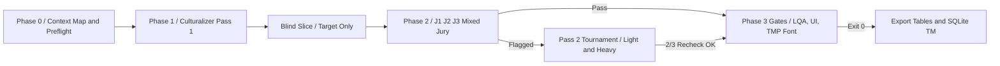

# Game Cultural Localization

**AI translated game text usually reads correct and still sounds translated. This plugin makes it sound native.** Built on a clean six layer Python 3.15 core (`domain`, `ports`, `aspects`, `application`, `infrastructure`, `composition`), it transforms machine drafts and raw translations into natural spoken game copy across 15 locales, backed by a blind three family LLM jury, automated token and cost optimization, and deterministic engine gates. Targeted at Antigravity, Claude Code, Gemini CLI, Cursor, Codex, and standalone LLM pipelines.

[](./CHANGELOG.md) [](https://github.com/rysesoft/game-cultural-localization/actions/workflows/tests.yml) [](./tests/README.md) [](#specification) [](./docs/architecture/NAVIGATION.md) [](#supported-languages) [](#specification) [](./LICENSE)

[Türkçe README](./README_TR.md) | [Architecture Map](./docs/architecture/NAVIGATION.md) | [CLI Reference](./skills/game-cultural-localization/scripts/CLI_REFERENCE.md) | [Methodology](./skills/game-cultural-localization/references/methodology_and_qa.md) | [Changelog](./CHANGELOG.md) | Maintained by [Rysesoft](https://github.com/rysesoft).

## At a Glance

| Pillar | Specification in v3.4.1 |
|---|---|
| Core Architecture | 6 layer SOLID, OOP, and AOP core under `skills/game-cultural-localization/scripts/gcl/` with thin CLI facades (`<= 260` lines) |
| Runtime Requirement | Single target Python 3.15 (`MIN_PYTHON = (3, 15)`), zero third party dependencies, slotted dataclasses, `StrEnum`, `match / case` |
| Blind Multi-Family Jury | Three escalating tiers (`J1`, `J2`, `J3`) combining Claude, Gemini, and DeepSeek over strict target only slices |
| Cost & Token Engine | `--batch` half price queues, Gemini `--flex` with `J3` stall exclusion, prompt cache priming, deduplication, and `pass2_light` routing |
| Deterministic Gates | Locale rules linter, UI length expansion guard, TextMesh Pro fallback glyph scanner, token parity check, strict YAML export |
| Quality Verification | `385` automated unit, AST architecture contract, Python 3.15 audit, and live mock HTTP streaming tests |

## The Problem

Machine and LLM drafts get the meaning right and the voice wrong. They keep English word order, reach for bureaucratic verbs and repeat pronouns the target language would drop. Players hear it within one line. The examples below come from the Golden Voice Anchors in the playbooks, so agents and humans calibrate on the same lines.

| Locale | Source (EN) | Typical MT or LLM output | What this suite expects | Why |
|---|---|---|---|---|
| `tr-TR` A1 Mentor | Start with whatever you can salvage and get the workshop running again. Do that, and I'll send a few contracts your way. | Mevcut malzemeleri geri dönüştürerek atölye operasyonlarını yeniden tesis et, ardından sana sözleşmeler aktaracağım. | Eldeki hurdadan ne çıkarabiliyorsan onunla başla, şu dükkânı yeniden ayağa kaldır. Çarkı bir döndür, kendi işlerimden birkaçını sana paslarım. | Bureaucratic verbs replaced with workshop talk, warm senior register kept |
| `de-DE` A1 Mentor | Same line | Beginne mit der Verwertung verfügbarer Materialien, um den Werkstattbetrieb wiederherzustellen, und ich werde Aufträge an dich übertragen. | Fang mit dem an, was du aus dem Schrott rausholen kannst, und bring den Laden wieder zum Laufen. Dann schieb ich dir ein paar von meinen Aufträgen rüber. | Spoken du register, no nominal style, no calqued future tense |
| `ja-JP` A4 Engineer | The generator's output is unstable. Don't run it above 80% until I've recalibrated the coils. | 発電機の出力は不安定です。私がコイルを再調整するまで、それを80%以上で稼働させないでください。 | 発電機の出力が安定してません。コイルを調整し直すまで、80%以上は出さないでくださいね。 | Redundant 私 and それ dropped, conversational 丁寧語 instead of manual speak |

The fourth column is what the suite aims for. The rest of this page shows how the architecture achieves it and proves the cost and quality numbers.

## Architecture and Pipeline



| Layer | What it does |
|---|---|
| Context (3.0) | Before any line is touched, `context-cartographer` (Claude Opus) and `context-scout` agents (Claude Sonnet) trace game code, scenes, prefabs and string tables, resolve ambiguity with the studio, and produce `CONTEXT_MAP.md`. Translators, critic and jury read it first, because the same word changes with the place (*Play* is *Oyna* for a game and *Çal* for music in Turkish) |
| Craft | 15 culturalization playbooks with Golden Voice Anchors and five voice archetypes. A culturalizer writes Pass 1 and Pass 2, and a native ear critic scores a blind slice that never exposes the English source |
| Measurement (2.2, 3.0) | Claude, Gemini and DeepSeek judge every line blind in three tiers, calibrated on a professional reference, and every change arrives with reason, evidence, confidence and a trust level |
| Optimization (3.1 to 3.4) | `--batch` halves Anthropic and Google prices, `--flex` halves Gemini J1/J2 latency-tolerant calls while `flex_exclude_roles` protects J3 from stalls, `J3 carbon` runs at calibrated `medium` effort, prompts stay compact and cache primed, clean `[5, 5, 4]` lines pass fast, and minor flags route to `pass2_light` (`claude-sonnet-5-5`) |
| Gates (3.4.1) | Pure Python linter, UI overflow checker, in process TextMesh Pro fallback glyph scanner (with dynamic atlas leniency), token parity guard, and critique validator with strict `0 / 1 / 2` exit codes |
| Engineering Governance | `verify_architecture.py` and `py315_audit.py` enforce layered imports, zero cycles, juror blindness (`BlindContextView`), OCP provider loading, module size caps (`<= 350` lines), facade caps (`<= 260` lines), and synced architecture maps |

### Layered Core Architecture

Starting in `3.2.0` and completed across `100%` of CLI tools in `3.4.0`, every business rule moved out of monolithic scripts into a strict six layer package under `skills/game-cultural-localization/scripts/gcl/`. Outer files in `scripts/` remain backward compatible thin facades (`<= 260` lines), while CI verifies architectural fitness automatically on every build.

| Layer | Package | Responsibility |
|---|---|---|
| Domain | `gcl.domain` | Pure immutable models (`Row`, `BlindEntry`, `CandidateSet`, `LineVerdict`), line state machine (`LineState`), errors, house punctuation rules, prompt compaction |
| Ports | `gcl.ports` | Protocol interfaces segregating LLM calls, storage/TM repositories, blind vs writer context views, events, formats, token parity |
| Aspects | `gcl.aspects` | Composable AOP chains for logging, `budget.jsonl` accounting, retry backoff, rate limiting, item memoization, batch coalescing |
| Application | `gcl.application` | Pipeline builder, prompt assembly, jury escalation and deliberation, Pass 2 tournament and recheck policies, calibration, LQA lint chains, change reporting |
| Infrastructure | `gcl.infrastructure` | HTTP adapters for Anthropic, Google Gemini and DeepSeek, batch job collector, SQLite TM repository, Unity YAML / PO / CSV / TMP font parsers, C# use site tracer |
| Composition | `gcl.composition` | `ServiceContainer` wiring live/dry-run routers, legacy and orchestrator workflows, language pack builder, and in process Phase 3 gates |

Full module map and dependency rules live in [NAVIGATION.md](./docs/architecture/NAVIGATION.md) and architecture decision records `ADR-001` through `ADR-005` under [docs/architecture/adr](./docs/architecture/adr/).

## Multi-Family Jury (2.2)

Version 2.2 replaces the single critic with a jury of three model families and measures how native the result sounds, without a human native reviewer in the loop. A family that likes its own style is outvoted by the two others.

| Step | What happens |
|---|---|
| Language pack | `build_language_pack.py` builds `langpack/<locale>/` from licensed game and UI corpora plus the studio's own translation. Copyleft sources stay on the local machine |
| Warm-up and pairs | `warmup_loader.py` puts 30 to 50 native lines into every prompt, `build_contrastive_set.py` pairs native lines with deliberately literal robot lines |
| Calibration | `eval_critic.py` checks that every juror prefers the native line in at least 85% of the pairs |
| Jury | `jury.py` runs three tiers of Claude, Gemini and DeepSeek on a blind slice. Clear lines settle early, critical lines go straight to J3, disagreements go through anonymous deliberation, and lines with `[5, 5, 5]` scores that still trigger locale `ban_hits` promote into Pass 2 (`send_ban_hit_lines_to_pass2`) |
| Rewrite | `pass2_rewrite.py` writes two candidates on `pass2_light` (minor flags) or three on `pass2` (critical), J1 picks blind, unanimously picked or `2/3` confirmed severe rewrites pass, and failed picks automatically retry voted runner-up candidates before reverting |
| Report | `report_changes.py` lists every change with old and new text, reason, evidence, confidence and votes. The developer accepts or rejects, `tm.py` remembers the decision and `export_translations.py` writes the result into the game's own tables |

**Agreement.** Every tier holds one model from each family. A line passes when all three scores are 4 or 5 and differ by at most 1 (in orchestrator runs, clean `[5, 5, 4]` lines with zero `odd_words` and zero `ban_hits` also settle at J1). Any score of 3 or lower, or a spread of 2 or more, moves the line up. Any score of 2 or lower goes straight to J3. When J3 disagrees, jurors read anonymized reasons and re-vote by majority.

**Everyday words first.** Before a juror scores a line it asks of every word whether a native speaker uses it in everyday life. When two of the three jurors of a tier flag a rare, bookish or dictionary word in the same line, the score is capped at 3 so the line moves to Pass 2 with the exact words to replace. Proper names, placeholders and the game's own terms are exempt.

**Budget caps.** When more than 30% of judged lines escalate to J2, or more than 10% to J3 after `min_judged` (`100`) lines and `min_escalated` (`10`) lines, the run stops cleanly and writes the report so prompt issues are caught before wasting budget.

**Trust levels.** Every change report states how strongly its verdicts are backed.

| Level | When | Meaning of a verdict |
|---|---|---|
| measured | professional reference and a passing calibration | measured against the professional translation |
| estimated | a language pack is installed | estimated from proxy signals |
| rule based | no language pack | only the rule based gates speak for the line |

### Turkish language pack

`langpack/tr-TR/` ships with the plugin. Its warm-up corpus holds 7054 lines, about 1400 from the professional Turkish translation of a Rysesoft game and the rest from Godot editor and Pixelorama translations (MIT). Copyleft corpora feed the pack only on the building machine and are never distributed. Calibrated live on 385 pairs using the leak checked English jury view (`CONTEXT_MAP.jury.md`), eight of the nine seats selected the studio translation between 85% and 95% of the time (`gemini-4-carbon` `94.8%`, `gemini-4-neon` `94.6%`, `gemini-4-hydrogen` `94.3%`, `claude-opus-5-5` `92.7%`), while Claude Haiku in J1 scored `83.4%` (`< 0.85`), so reports honestly mark Turkish as `estimated`. Packs for thirteen more locales ship alongside it (`ru-RU`, `de-DE`, `es-ES`, `fr`, `it-IT`, `ja-JP`, `ko-KR`, `lt-LT`, `pl-PL`, `pt-BR`, `pt-PT`, `zh-CN`, `zh-Hant`).

**Try it without a key.** Every tool runs offline with `--dry-run`. Run this from `skills/game-cultural-localization/` to see the full flow.

```bash
python scripts/orchestrator_stub.py --dry-run --locale tr-TR --input strings.json --workdir out/
```

For production games, generate `CONTEXT_MAP.md` first and pass `--context-map loc_work/context/CONTEXT_MAP.md`. API keys read from `ANTHROPIC_API_KEY`, `GOOGLE_API_KEY` and `DEEPSEEK_API_KEY`. `--live` executes real API calls, `--batch` enables half price async batch queues, `--flex` enables Gemini flex pricing safely, and `budget_report.py` summarizes exact token usage and full project cost estimates. Details live in [methodology_and_qa.md](./skills/game-cultural-localization/references/methodology_and_qa.md) and [CLI_REFERENCE.md](./skills/game-cultural-localization/scripts/CLI_REFERENCE.md).

## Live Benchmark Proof

Measured live across Anthropic, Google Gemini and DeepSeek APIs on synthetic game localization benchmarks comparing `v3.1` Legacy defaults against `v3.4.0` and `v3.4.1` (`tr-TR`, `budget_report.py` verified telemetry).

| Benchmark Scenario | Metric | Legacy (`3.1` defaults) | Upgraded (`3.4.0` / `3.4.1`) | Measured Delta |
|---|---|---|---|---|
| **Clean 14-row batch** (`v3.4.0` sync) | Total cost USD | `$0.19225` | `$0.09121` | **`-52.6%`** (`$0.04659` simulated batch) |
| Clean 14-row batch | API calls / model latency | `14` calls / `107.84s` | `11` calls / `55.51s` | **`-21.4%`** calls, **`-48.5%`** latency |
| Clean 14-row batch | `1666` rows x `13` locales proj | `$297.41` | `$141.10` | **`-52.6%`** (`$72.08` batch mode) |
| **Flawed 8-row stress test** (`v3.4.1 --live --flex`) | Total cost USD | `$0.77510` | `$0.33617` | **`-56.6%`** (`-61.6%` vs `v3.4.0`) |
| Flawed 8-row stress test | `J3 gemini-4-carbon` cost / thought | `$0.47355` / `21669` | `$0.08371` / `2115` | **`-82.3%`** cost, **`-90.2%`** thought |
| Flawed 8-row stress test | Prompt cache read tokens | `15616` | `45030` | **`+188.4%`** cache reuse |
| Flawed 8-row stress test | Defects resolved / LQA exit code | `5/7` fixed / Exit `1` | **`7/7` fixed / Exit `0`** | **`100%`** fix rate, `0` LQA findings |

## Versioning and Release History

This repository follows strict **Semantic Versioning (`MAJOR.MINOR.PATCH`)** with automated lockstep enforcement tested in CI. Every CLI exposes `--version`, and `tests/test_docs_style.py` refuses any commit where versions drift apart across manifests or docs.

**Version Bump Rules.**
- **MAJOR (`X.0.0`)** signals breaking protocol or artifact contract shifts (such as `3.0.0` requiring `CONTEXT_MAP.md` and jury blindness views before any word is touched).
- **MINOR (`3.X.0`)** delivers major engine capabilities, runtime modernizations or architectural layer expansions while keeping outer CLI flags compatible (`3.1.0` batch mode, `3.2.0` SOLID/AOP core + Phase M cost cuts, `3.3.0` native Python 3.15 modernization, `3.4.0` 100% facade extraction).
- **PATCH (`3.4.X`)** ships verified live calibration improvements, gate refinements and bug fixes with zero breaking schema changes (`3.4.1` J3 effort calibration, flex safety, lenient dynamic TMP fonts, recheck `2/3` policy).

**Lockstep Manifest Locations.** Every release increments one single version string across [plugin.json](./plugin.json), [errors.py](./skills/game-cultural-localization/scripts/gcl/domain/errors.py) (`l10n_common.__version__`), [CLI_REFERENCE.md](./skills/game-cultural-localization/scripts/CLI_REFERENCE.md), and [CHANGELOG.md](./CHANGELOG.md).

| Release | Date | Theme and Key Capabilities |
|---|---|---|
| **`3.4.1`** (Current) | 2026-11-28 | Live `--flex` stability (`flex_exclude_roles`), Google `J3` `medium` effort (`-56.6%` stress cost), lenient dynamic TMP font gates, Pass 2 `2/3` recheck + runner-up fallback, `ban_hits` routing |
| **`3.4.0`** | 2026-11-28 | `100%` SOLID, OOP & AOP extraction of all remaining tools (`gcl/`), immutable verdict aggregates, `RateLimit/Retry/BatchCoalesce` aspects, `<= 260` line CLI facade cap |
| **`3.3.0`** | 2026-11-28 | Pure native Python 3.15 runtime (`MIN_PYTHON = (3, 15)`), `slots=True` across all `43` dataclasses, `StrEnum`, `match / case`, `itertools.batched`, `compression.zstd`, `InterpreterPoolExecutor`, `py315_audit.py` |
| **`3.2.0`** | 2026-11-28 | 6 layer `gcl/` architecture (`domain`, `ports`, `aspects`, `application`, `infrastructure`, `composition`), Phase M cost & token optimizations, prompt compaction, `--flex`, `pass2_light`, TM trigram caching |
| **`3.1.0`** | 2026-11-27 | Batch API mode (`0.5x` Anthropic/Google), larger batches + cache priming, batched deliberation (`deliberate_many`), C# use site tracing (`--scan`), TMP fallback chain, [Devlog](./docs/devlog/2026-11-27-v3.1.0.md) |
| **`3.0.0`** | 2026-11-27 | Mandatory `CONTEXT_MAP.md` (`context-cartographer` + `context-scout`), `Contexts Decide Every Word` (Law 5), everyday word check, leak free jury view, `export_translations.py`, 14 language packs |
| **`2.2.0`** | 2026-11-26 | Three family LLM jury (`Claude`, `Gemini`, `DeepSeek`), contrastive calibration (`eval_critic.py`), SQLite TM (`tm.py`), anonymous deliberation, trust cards |

Full commit by commit notes live in [CHANGELOG.md](./CHANGELOG.md).

## What You Get

1. **15 culturalization playbooks** with Golden Voice Anchors tagged with five voice archetypes (A1 to A5).
2. **Four agent prompts.** A context cartographer and its context scouts that map the game before the first line, a culturalizer for Pass 1 and Pass 2, and a blind native ear critic that only reads a target only slice and the English jury map.
3. **Native jury prompts in all 15 languages.** Every locale has its own critic and Pass 2 prompt, written in that language with a local player or writer persona.
4. **Six layer SOLID + AOP Python 3.15 core.** Zero dependencies, slotted immutable aggregates, protocol ports, composable transport/task aspects, and automated AST architecture audits.
5. **Deterministic engine gates.** Locale rules linter, UI overflow checker, TextMesh Pro fallback glyph scanner (supporting dynamic atlases), blind slice generator, token parity guard, and critique validator.
6. **Mixed-family LLM jury with cost engine.** Claude, Gemini and DeepSeek judge blind across three tiers with `--batch`, `--flex`, prompt caching, item memoization, and calibrated `J3` thinking budgets.

## Supported Languages

| Locale | Playbook | Notes |
|---|---|---|
| `en` | [en.md](./skills/game-cultural-localization/references/en.md) | Source polish only (placeholder English, concatenation hygiene) |
| `tr-TR` | [tr-TR.md](./skills/game-cultural-localization/references/tr-TR.md) | Suffix and apostrophe rules for placeholders, built & calibrated language pack |
| `de-DE` | [de-DE.md](./skills/game-cultural-localization/references/de-DE.md) | Perfekt vs Präteritum, du/Sie lock, ẞ handling |
| `fr` | [fr.md](./skills/game-cultural-localization/references/fr.md) | Covers fr-FR, with a fr-CA note for Québec terminology and spacing |
| `es-ES` | [es-ES.md](./skills/game-cultural-localization/references/es-ES.md) | Peninsular Spanish, tú/usted |
| `it-IT` | [it-IT.md](./skills/game-cultural-localization/references/it-IT.md) | Passato prossimo, tu/Lei |
| `pt-BR` | [pt-BR.md](./skills/game-cultural-localization/references/pt-BR.md) | Brazilian, separate from pt-PT, leak checks both ways |
| `pt-PT` | [pt-PT.md](./skills/game-cultural-localization/references/pt-PT.md) | European, tu/você, separate playbook |
| `pl-PL` | [pl-PL.md](./skills/game-cultural-localization/references/pl-PL.md) | Three plural forms, gender neutral past tense |
| `lt-LT` | [lt-LT.md](./skills/game-cultural-localization/references/lt-LT.md) | Plural forms, vocative, diacritic font check |
| `ru-RU` | [ru-RU.md](./skills/game-cultural-localization/references/ru-RU.md) | Three plural forms, канцелярит ban list, ты/вы |
| `ja-JP` | [ja-JP.md](./skills/game-cultural-localization/references/ja-JP.md) | 役割語, UI register lock, counters, 禁則処理 |
| `ko-KR` | [ko-KR.md](./skills/game-cultural-localization/references/ko-KR.md) | 화계 lock, particle traps after placeholders |
| `zh-CN` | [zh-CN.md](./skills/game-cultural-localization/references/zh-CN.md) | Simplified, Mainland terminology and compliance notes |
| `zh-Hant` | [zh-Hant.md](./skills/game-cultural-localization/references/zh-Hant.md) | Traditional, Taiwan default with a Hong Kong subsection (`--variant hk`) |

## Why This Is Different

| Capability | Plain MT or LLM prompt | CAT tool AI plugins | This suite (`v3.4.1`) |
|---|---|---|---|
| Blind native ear critique (AST + runtime enforced source isolation) | no | no | yes, `BlindContextView` + `make_blind_slice.py` + AST contract check |
| Native quality measured by a calibrated three family jury | no | no | yes, `jury.py` with `eval_critic.py` calibration |
| Per language culturalization playbook and five voice archetypes | no | partial (style guides) | yes, 15 playbooks on one template |
| Built in `--batch` (`0.5x`), `--flex`, cache priming & light pass routing | no | no | yes, up to `56%` to `76%` measured live cost reduction |
| Deterministic gates with exit codes 0/1/2 and TMP fallback scanning | no | partial (QA checks) | yes, linter, UI overflow, TMP dynamic/static font, parity |
| Engine independent tokens (Unity, Unreal, Godot, ICU, printf) | partial | partial | yes, parity checked per style |
| Zero dependencies & SOLID architecture | n/a | no | yes, pure Python 3.15 stdlib, `verify_architecture.py` verified |
| Gender neutral player voice and regional leak detection | no | no | yes, playbook rules + data driven locale rule tables |

## How It Works (Phase 0 to 3)

| Phase | What happens | Gate |
|---|---|---|
| 0 Context map and preflight | `context-cartographer` and `context-scout` write `CONTEXT_MAP.md` and ask what stays unclear, then checksums, C# concatenation scan, TMP font glyph scan, `<LOCALE>_BIBLE.md`, transcreation ledger | Line notes for every key, open questions answered, seams recorded, 0 blocking missing glyphs |
| 1 Clean room Pass 1 | `game-culturalizer` translates source batches (or preserves `--draft-field` for review) calibrated on the playbook, archetypes, SQLite TM, and warm-up corpus | `lqa_linter.py` exit 0 per batch |
| 2 Blind critique and Pass 2 | `make_blind_slice.py` strips source, mixed jury scores lines blindly, consensus & `ban_hits` trigger `pass2_light` or full Pass 2 tournament with `2/3` recheck and runner-up fallback | Rewritten lines verified clean, unresolved flagged cleanly |
| 3 Automated gate | `lqa_linter.py --fail-on-error`, `ui_expansion_checker.py --fail-on-high`, in process `font_glyph_scanner.py`, table export via `export_translations.py` | Exit `0`, strict YAML valid, only target locale files touched |

The five archetypes are A1 Mentor, A2 Hotshot Rival, A3 Rookie, A4 Scientist and A5 Antagonist. UI text uses the locked UI register of the locale instead. With `--dry-run` or `--live` the orchestrator runs Phase 2 as the jury flow described above. Full per phase runbook lives in [methodology_and_qa.md](./skills/game-cultural-localization/references/methodology_and_qa.md).

## Install

The skill folder follows the open [Agent Skills](https://agentskills.io/specification) format, so the same `skills/game-cultural-localization/` directory loads in several tools. Paths below come from each vendor's official documentation.

| Tool | Playbooks and scripts (skill) | Agents | Rules | Workflow template |
|---|---|---|---|---|
| Antigravity | yes, plugin install | yes, `agents/*.md` as is | yes, `rules/AGENTS.md` | yes, `/run-workflow` |
| Claude Code | yes, `~/.claude/skills/` or `.claude/skills/` | yes, copy to `.claude/agents/` and set `tools:` to Claude names (`Read, Write, Bash`) | manual, paste into `CLAUDE.md` | no, use `orchestrator_stub.py` |
| Gemini CLI | yes, `~/.gemini/skills/` or `.gemini/skills/` (`.agents/skills/` alias) | manual, as system prompts | manual, paste into `GEMINI.md` | no |
| Cursor | yes, `.agents/skills/` or `.cursor/skills/` (also reads `.claude/skills/`) | manual, as subagent prompts | yes, `AGENTS.md` or `.cursor/rules/` | no |
| OpenAI Codex | yes, `.agents/skills/` in the repo or `~/.agents/skills/` | manual, as system prompts | yes, `AGENTS.md` at the repo root | no |
| Any LLM API | yes, attach files as context | yes, prompt bodies | yes, prepend to the system prompt | `orchestrator_stub.py` |

**Antigravity**

```bash
agy plugin validate --strict ./game-cultural-localization
agy plugin install ./game-cultural-localization
```

Or copy the folder to `~/.gemini/config/plugins/game-cultural-localization/` (global) or `<project>/.agents/plugins/game-cultural-localization/` (workspace). Then type `/game-cultural-localization`, pick a suggested prompt, or select `game-culturalizer` as the main agent (`agy --agent game-culturalizer`). Start a new conversation after updating the plugin.

**Claude Code, Gemini CLI, Cursor, Codex**

```bash
# project scope, pick the directory your tool reads (see the table)
cp -r game-cultural-localization/skills/game-cultural-localization .agents/skills/
cp -r game-cultural-localization/skills/game-cultural-localization .claude/skills/
cat game-cultural-localization/rules/AGENTS.md >> AGENTS.md
```

The skill's `name` and `description` are loaded at session start and the body on demand in every listed tool. Scripts require Python 3.15+ (`python` or `py -3.15`) and work identically everywhere.

**Any LLM API or CAT tool**

1. Use [agents/game-culturalizer.md](./agents/game-culturalizer.md) as the system prompt for Pass 1 and Pass 2, and [agents/native-ear-critic.md](./agents/native-ear-critic.md) for critique. Attach [SKILL.md](./skills/game-cultural-localization/SKILL.md) and the target playbook.
2. Send `in_<locale>_<batch>.json` and save `pass1_<locale>_<batch>.json`.
3. Run `make_blind_slice.py`, score the target only slice in a fresh conversation, save `critique_<locale>_<batch>.json`, and validate via `validate_critique.py`.
4. Run Pass 2 using the validated critique, then enforce Phase 3 gates (`orchestrator_stub.py --live` automates the entire pipeline with multi-family juries, caching, batch/flex pricing and SQLite TM).

## CLI Summary

Run from `skills/game-cultural-localization/`. Every flag is documented in [CLI_REFERENCE.md](./skills/game-cultural-localization/scripts/CLI_REFERENCE.md).

```bash
python scripts/providers_check.py --ping
python scripts/orchestrator_stub.py strings.json --locale tr-TR --workdir out/ --live --flex --context-map loc_work/context/CONTEXT_MAP.md
python scripts/font_glyph_scanner.py --input strings.en.json --dst-field en --font ./Fonts/UI.ttf --font ./Fonts/Fallback.ttc
python scripts/lqa_linter.py --input final_de-DE.json --locale de-DE --src-field en --dst-field dst --json lqa_de-DE.json --fail-on-error
python scripts/ui_expansion_checker.py --input final_de-DE.json --locale de-DE --src-field en --dst-field dst --json ui_de-DE.json --fail-on-high
python scripts/budget_report.py out/budget.jsonl --rows 1666 --project-locales 13 --json
```

## Specification

| Item | Value |
|---|---|
| Release & Locales | `v3.4.1`, 15 supported locales (`en` + 14 targets), aliases mapped (`de` to `de-DE`, `pt_BR` to `pt-BR`, `zh-TW` and `zh-HK` to `zh-Hant`) |
| Input Formats | JSON list, JSON dict, CSV, TSV, Gettext PO (multi line and plural `msgstr`), Unity Localization StringTable `.asset` |
| Placeholder Styles | `auto`, `unity` (`{0}`, `{name}`, Smart Strings), `unreal` (`{Name}`, `\|hpp`), `godot` (`%s`, `{name}`), `icu` (plural and select), `printf`, `python` |
| Tag Styles | `tmp` (`<b> <color=> <sprite=> <style=> <link=>`), `html`, `bbcode` (`[b] [color=] [url=]`) |
| Runtime & Storage | Python 3.15, zero external dependencies, UTF-8 BOM tolerant, `.zst` Zstandard compressed memo caches, SQLite trigram TM |
| Exit Codes | `0` clean, `1` findings (errors, `--fail-on-warn` warnings, `--fail-on-high` UI overflow), `2` invalid input or CLI usage |
| Context & Blindness | Project `CONTEXT_MAP.md` drives every lexical choice. Jurors receive only `CONTEXT_MAP.jury.md` and `line_notes.jury.json`, verified via `--check-leak` and AST checks |
| Critique Schema | `critique_<locale>_<batch>.json`, 1 to 5 score, issue type, `odd_words`, suggested fix, validated strictly by `validate_critique.py` |

Input row example (only `key` and `en` are required) and critique entry example.

```json
{"key": "dlg.mentor.intro_01", "en": "Take your time, kid. The {itemName} isn't going anywhere.", "category": "dialogue", "speaker": "Mentor", "archetype": "A1"}
```

```json
{"locale": "de-DE", "source_file": "blind_de-DE_01.json",
 "entries": [{"key": "dlg.mentor.intro_01", "score": 3, "issue_type": "translationese",
              "reason": "Calqued English word order.", "suggested": "Lass dir Zeit. Der {itemName} läuft dir nicht weg."}],
 "summary": {"total": 120, "flagged": 1, "critical": 0}}
```

Issue types are `translationese`, `register`, `tense`, `regional_leak`, `gender_leak`, `ui_verb`, `placeholder_grammar`, `terminology` and `other` (with optional `needs_source_check`).

### File layout

```text
plugin.json                 Antigravity manifest (v3.4.1 source of truth)
README.md, README_TR.md     English and Turkish product documentation
CHANGELOG.md                Full release log mapped cleanly to CLI tools
AGENTS.md, CLAUDE.md        AI coding agent onboarding and non-negotiable guardrails
docs/
  architecture/             Self-maintaining NAVIGATION.md, architecture memory and ADR-001..005
  devlog/                   Field reports and production cost case studies
rules/AGENTS.md             Always-on localization rules
agents/                     context-cartographer, context-scout, game-culturalizer, native-ear-critic
skills/game-cultural-localization/
  SKILL.md                  Agent Skills entry point, voice archetypes, 8 laws
  references/               15 locale playbooks, methodology_and_qa.md, transcreation_ledger_guide.md
  scripts/                  Thin <=260 line CLI facades, rules/<locale>.json, CLI_REFERENCE.md, providers.config.json
    gcl/                    6-layer SOLID + OOP + AOP core (domain, ports, aspects, application, infrastructure, composition)
    dev/                    verify_architecture.py, py315_audit.py, sync_navigation.py, hook_runner.py
  prompts/                  Native critic and Pass 2 prompts for all 15 locales plus literal.md
  langpack/                 sources.manifest.json and 14 built language packs (tr-TR calibrated on 385 pairs)
tests/                      385 automated unit, style, Python 3.15 audit and architecture contract tests
.github/                    CI workflow on Python 3.15, issue and PR templates
```

## Contributing

Pull requests are welcome. Before opening a PR, run the full verification suite (`python -B -m unittest discover -s tests -t .`, `python -B skills/game-cultural-localization/scripts/dev/verify_architecture.py`, and `agy plugin validate --strict .` if available). Keep playbooks on the 12 section template, bump versions in lockstep across [plugin.json](./plugin.json), [errors.py](./skills/game-cultural-localization/scripts/gcl/domain/errors.py), [CLI_REFERENCE.md](./skills/game-cultural-localization/scripts/CLI_REFERENCE.md), and [CHANGELOG.md](./CHANGELOG.md), and update `README.md` together with `README_TR.md` so CI section parity checks stay green. Templates live in [.github](./.github/).

## License

[MIT](./LICENSE). Maintained by Rysesoft.
