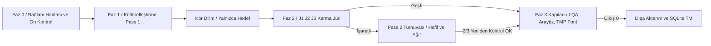

# Game Cultural Localization

**Yapay zekâyla çevrilen oyun metni çoğu zaman doğru okunur ama yine de çeviri olduğu belli olur. Bu eklenti metni oyuncunun kendi dilinde yazılmış gibi seslendirir.** Altı katmanlı temiz bir Python 3.15 çekirdeği (`domain`, `ports`, `aspects`, `application`, `infrastructure`, `composition`) üzerine kurulu bu paket, makine ya da LLM taslaklarını 15 dilde doğal oyun metnine dönüştürür, üç ayrı model ailesinden oluşan kör bir jüriyle satır satır denetler ve maliyeti otomatik düşürerek deterministik motor kapılarından geçirir. Antigravity, Claude Code, Gemini CLI, Cursor, Codex ve düz LLM API hatları için tasarlandı.

[](./CHANGELOG.md) [](https://github.com/rysesoft/game-cultural-localization/actions/workflows/tests.yml) [](./tests/README.md) [](#teknik-özellikler) [](./docs/architecture/NAVIGATION.md) [](#desteklenen-diller) [](#teknik-özellikler) [](./LICENSE)

[English README](./README.md) | [Mimari Harita](./docs/architecture/NAVIGATION.md) | [CLI Referansı](./skills/game-cultural-localization/scripts/CLI_REFERENCE.md) | [Metodoloji](./skills/game-cultural-localization/references/methodology_and_qa.md) | [Değişiklik Günlüğü](./CHANGELOG.md) | Geliştiren [Rysesoft](https://github.com/rysesoft).

## Genel Bakış

| Alan | v3.4.1 Özeti |
|---|---|
| Çekirdek Mimari | `skills/game-cultural-localization/scripts/gcl/` altında 6 katmanlı SOLID, OOP ve AOP çekirdeği, ince CLI arayüzleri (`<= 260` satır) |
| Çalışma Ortamı | Tek hedef Python 3.15 (`MIN_PYTHON = (3, 15)`), sıfır harici bağımlılık, `slots=True` veri sınıfları, `StrEnum`, `match / case` |
| Çok Aileli Kör Jüri | Kaynaktan izole kör dilimler üzerinde Claude, Gemini ve DeepSeek modellerinden oluşan 3 yükselen kademe (`J1`, `J2`, `J3`) |
| Maliyet ve Token Motoru | `--batch` yarı fiyat kuyrukları, `J3` kuyruk korumalı Gemini `--flex`, istem önbellekleme, tekilleştirme ve `pass2_light` yönlendirmesi |
| Deterministik Kapılar | Dil kuralı denetçisi, arayüz taşma kontrolü, TextMesh Pro yedek zincirli font tarayıcı, yer tutucu eşliği ve katı YAML aktarımı |
| Kalite Güvencesi | `385` birim, AST mimari sözleşmesi, Python 3.15 denetimi ve sahte HTTP akış testi |

## Sorun

Makine ve LLM taslakları anlamı doğru, sesi yanlış verir. İngilizce kelime sırasını korur, resmî yazışma fiillerine sarılır ve hedef dilin hiç kullanmayacağı zamirleri tekrar tekrar yazar. Oyuncu bunu ilk satırda duyar. Aşağıdaki örnekler dil rehberlerindeki Golden Voice Anchors satırlarından alındı, böylece ajanlar da insanlar da aynı satırlar üzerinden ayar yapar.

| Dil | Kaynak (EN) | Tipik MT ya da LLM çıktısı | Bu paketin beklediği | Neden |
|---|---|---|---|---|
| `tr-TR` A1 Usta | Start with whatever you can salvage and get the workshop running again. Do that, and I'll send a few contracts your way. | Mevcut malzemeleri geri dönüştürerek atölye operasyonlarını yeniden tesis et, ardından sana sözleşmeler aktaracağım. | Eldeki hurdadan ne çıkarabiliyorsan onunla başla, şu dükkânı yeniden ayağa kaldır. Çarkı bir döndür, kendi işlerimden birkaçını sana paslarım. | Bürokratik fiillerin yerini atölye dili aldı, kıdemli ustanın sıcak sesi korundu |
| `de-DE` A1 Usta | Aynı satır | Beginne mit der Verwertung verfügbarer Materialien, um den Werkstattbetrieb wiederherzustellen, und ich werde Aufträge an dich übertragen. | Fang mit dem an, was du aus dem Schrott rausholen kannst, und bring den Laden wieder zum Laufen. Dann schieb ich dir ein paar von meinen Aufträgen rüber. | Konuşma dilinde du hitabı, isim cümlesi yok, İngilizceden kopyalanmış gelecek zaman yok |
| `ja-JP` A4 Mühendis | The generator's output is unstable. Don't run it above 80% until I've recalibrated the coils. | 発電機の出力は不安定です。私がコイルを再調整するまで、それを80%以上で稼働させないでください。 | 発電機の出力が安定してません。コイルを調整し直すまで、80%以上は出さないでくださいね。 | Gereksiz 私 ve それ atıldı, kullanım kılavuzu dili yerine sohbet havasında 丁寧語 |

Dördüncü sütun paketin ulaşmak istediği sonuç. Sayfanın geri kalanı mimarinin bunu nasıl sağladığını ve rakamlarla nasıl kanıtladığını gösteriyor.

## Mimari ve İş Akışı



| Katman | Ne yapar |
|---|---|
| Bağlam (3.0) | Tek bir satıra dokunulmadan önce `context-cartographer` (Claude Opus) ve `context-scout` ajanları (Claude Sonnet) oyunun kodunu, sahnelerini, prefab'larını ve metin tablolarını inceler, belirsiz kalan her şeyi stüdyoya sorar ve `CONTEXT_MAP.md` yazar. Çevirmen, eleştirmen ve jüri işe bu haritayı okuyarak başlar, çünkü aynı kelime yerine göre değişir (*Play* bir oyun için *Oyna*, müzik için *Çal* olur) |
| Zanaat | Golden Voice Anchors satırları ve beş ses arketipi içeren 15 kültürelleştirme rehberi. Kültürelleştirme ajanı Pass 1 ve Pass 2'yi yazar, anadil kulağı denetçisi İngilizceyi hiç göstermeyen kör bir dilimi puanlar |
| Ölçüm (2.2, 3.0) | Claude, Gemini ve DeepSeek her satırı üç kademede kör değerlendirir, profesyonel bir referansla kalibre edilir ve her değişiklik gerekçe, kanıt, güven oranı ve güven seviyesiyle sunulur |
| Optimizasyon (3.1 ile 3.4) | `--batch` Anthropic ve Google maliyetini yarıya düşürür, `--flex` J1/J2 çağrılarını hızlandırırken `flex_exclude_roles` J3 kilitlenmesini önler, `J3 carbon` kalibreli `medium` çabayla çalışır, temiz `[5, 5, 4]` satırlar hızlı geçer ve hafif düzeltmeler `pass2_light` (`claude-sonnet-5-5`) hattına yönlenir |
| Kapılar (3.4.1) | Saf Python linter, arayüz taşma kontrolü, süreç içi TextMesh Pro yedek glif tarayıcısı (dinamik atlas esnekliği dahil), yer tutucu eşliği koruması ve `0 / 1 / 2` çıkış kodlu eleştiri doğrulayıcısı |
| Mühendislik Yönetişimi | `verify_architecture.py` ve `py315_audit.py` tek yönlü katman bağımlılığını, sıfır döngüyü, jüri körlüğünü (`BlindContextView`), OCP sağlayıcı kaydını, modül boyut sınırlarını (`<= 350` satır) ve dış cephe sınırlarını (`<= 260` satır) otomatik denetler |

### Katmanlı Çekirdek Mimarisi

`3.2.0` ile başlayan ve `3.4.0` sürümünde tüm araçlarda `%100` tamamlanan mimari dönüşümle bütün iş mantığı `skills/game-cultural-localization/scripts/gcl/` altındaki altı katmanlı çekirdeğe taşındı. `scripts/` içindeki dış betikler geriye dönük uyumlu ince cepheler (`<= 260` satır) olarak korunur, CI her değişiklikte mimari sözleşmeleri denetler.

| Katman | Paket | Sorumluluk |
|---|---|---|
| Domain | `gcl.domain` | Değişmez domain modelleri (`Row`, `BlindEntry`, `CandidateSet`, `LineVerdict`), satır durum makinesi (`LineState`), hatalar, yazım kuralları, prompt sıkıştırma |
| Ports | `gcl.ports` | LLM çağrıları, depolama/TM depoları, kör ve yazar bağlam görünümleri, olaylar, dosya biçimleri ve yer tutucu eşliği arayüzleri |
| Aspects | `gcl.aspects` | Loglama, `budget.jsonl` maliyet kaydı, geri çekilme ve tekrar deneme, hız sınırı, öğe önbellekleme ve toplu istek birleştirme zincirleri |
| Application | `gcl.application` | Boru hattı kurucusu, prompt üretimi, jüri yükseltme ve müzakere, Pass 2 turnuvası ve yeniden kontrol ilkeleri, kalibrasyon, LQA kural zinciri ve raporlama |
| Infrastructure | `gcl.infrastructure` | Anthropic, Google Gemini ve DeepSeek HTTP adaptörleri, batch toplayıcı, SQLite TM deposu, Unity YAML / PO / CSV / TMP font ayrıştırıcıları ve C# kullanım izleyici |
| Composition | `gcl.composition` | Canlı/çevrimdışı yönlendiricileri, orkestratör ve eski akışları, dil paketi kurucusunu ve süreç içi Faz 3 kapılarını bağlayan `ServiceContainer` |

Tüm modül haritası [NAVIGATION.md](./docs/architecture/NAVIGATION.md) dosyasında, mimari karar kayıtları ise [docs/architecture/adr](./docs/architecture/adr/) klasöründe (`ADR-001` ile `ADR-005` arası) yer alır.

## Çok Aileli Jüri (2.2)

2.2 sürümü tek denetçinin yerine üç model ailesinden oluşan bir jüri koyar ve sonucun ne kadar doğal göründüğünü döngüde anadili konuşan bir insan olmadan ölçer. Kendi üslubunu kayıran bir aileyi diğer ikisi oylamada geçer.

| Adım | Ne olur |
|---|---|
| Dil paketi | `build_language_pack.py`, lisanslı oyun ve arayüz derlemleriyle stüdyonun kendi çevirisinden `langpack/<locale>/` klasörünü kurar. Copyleft kaynaklar yerel makinede kalır |
| Isınma ve çiftler | `warmup_loader.py` her prompta 30 ile 50 arası doğal satır ekler, `build_contrastive_set.py` doğal satırları bilerek kelimesi kelimesine çevrilmiş robot satırlarla eşler |
| Kalibrasyon | `eval_critic.py` her jüri üyesinin çiftlerin en az %85'inde doğal satırı seçtiğini kontrol eder |
| Jüri | `jury.py` kör dilim üzerinde Claude, Gemini ve DeepSeek'ten oluşan üç kademeyi çalıştırır. Net satırlar erkenden karara bağlanır, kritik satırlar doğrudan J3'e gider, anlaşmazlıklar anonim müzakereden geçer, `[5, 5, 5]` alıp yine de `ban_hits` tetikleyen satırlar otomatik Pass 2'ye yönlendirilir (`send_ban_hit_lines_to_pass2`) |
| Yeniden yazım | `pass2_rewrite.py`, `pass2_light` üzerinde 2, tam `pass2` üzerinde 3 aday yazar. J1 kör seçim yapar, oybirliğiyle seçilenler veya ağır satırlarda `2/3` onay alanlar geçer, reddedilenlerde oylanan yedek adaylar otomatik denenir |
| Rapor | `report_changes.py` her değişikliği eski ve yeni metin, gerekçe, kanıt, güven oranı ve oylarla listeler. Geliştirici kabul eder ya da reddeder, `tm.py` kararı hatırlar, `export_translations.py` sonucu oyunun kendi tablolarına yazar |

**Uzlaşma.** Her kademede her aileden bir model bulunur. Üç puanın hepsi 4 ya da 5 ise ve aralarındaki fark en fazla 1 ise satır geçer (orkestratör koşularında sıfır `odd_words` ve sıfır `ban_hits` taşıyan temiz `[5, 5, 4]` satırlar da J1'de onaylanır). 3 ve altı puanlar ya da 2+ puan farkı satırı yukarı taşır. 2 ve altı bir puan satırı doğrudan J3'e gönderir. J3 anlaşmazlıkları anonim gerekçelerle yeniden oylanır.

**Önce gündelik kelimeler.** Jüri üyesi bir satıra puan vermeden önce her kelimesinin gündelik hayatta kullanılıp kullanılmadığını kontrol eder. Bir kademedeki üç üyeden ikisi nadir veya sözlük işi bir kelime işaretlerse satırın tavan puanı 3'e düşer ve değiştirilecek kelimeler Pass 2'ye iletilir. Özel adlar, yer tutucular ve oyunun kendi terimleri muaftır.

**Bütçe sınırları.** Değerlendirilen satırlar `min_judged` (`100`) ve `min_escalated` (`10`) eşiklerini geçtikten sonra J2 oranı `%30`'u veya J3 oranı `%10`'u aşarsa koşu temizce durur ve raporu yazar, böylece prompt kaynaklı hatalar bütçeyi tüketmeden yakalanır.

**Güven seviyeleri.** Her değişiklik raporu kararlarına ne kadar güvenilebileceğini belirtir.

| Seviye | Ne zaman | Kararın anlamı |
|---|---|---|
| measured (ölçülmüş) | profesyonel referans ve geçilmiş bir kalibrasyon | profesyonel çeviriye göre ölçülmüş |
| estimated (tahmini) | bir dil paketi kurulu | dolaylı sinyallerden tahmin edilmiş |
| rule based (kurala dayalı) | dil paketi yok | satır hakkında yalnızca kurala dayalı kapılar söz sahibi |

### Türkçe dil paketi

`langpack/tr-TR/` eklentiyle birlikte gelir. Isınma derleminde 7054 satır bulunur, yaklaşık 1400'ü bir Rysesoft oyununun profesyonel Türkçe çevirisinden, geri kalanı Godot editörü ve Pixelorama çevirilerinden (MIT) gelir. Copyleft kaynaklar yalnızca kurulum makinesinde kalır ve dağıtılmaz. Sızıntı denetiminden geçmiş İngilizce jüri haritası (`CONTEXT_MAP.jury.md`) ile 385 çift üzerinde canlı yapılan kalibrasyonda dokuz koltuğun sekizi stüdyo çevirisini yüzde 85 ile 95 arasında doğrulukla seçmiştir (`gemini-4-carbon` `%94.8`, `gemini-4-neon` `%94.6`, `gemini-4-hydrogen` `%94.3`, `claude-opus-5-5` `%92.7`). J1'deki Claude Haiku `%83.4` (`< 0.85`) düzeyinde kaldığı için raporlar Türkçeyi dürüstçe `estimated` olarak işaretler. Diğer on üç dilin paketleri (`ru-RU`, `de-DE`, `es-ES`, `fr`, `it-IT`, `ja-JP`, `ko-KR`, `lt-LT`, `pl-PL`, `pt-BR`, `pt-PT`, `zh-CN`, `zh-Hant`) de eklentiyle gelir.

**Anahtarsız deneyin.** Her araç `--dry-run` ile çevrimdışı çalışır. Akışın tamamını görmek için bu komutu `skills/game-cultural-localization/` klasöründen çalıştırın.

```bash
python scripts/orchestrator_stub.py --dry-run --locale tr-TR --input strings.json --workdir out/
```

Gerçek projelerde önce `CONTEXT_MAP.md` haritasını üretip `--context-map loc_work/context/CONTEXT_MAP.md` parametresiyle verin. API anahtarları `ANTHROPIC_API_KEY`, `GOOGLE_API_KEY` ve `DEEPSEEK_API_KEY` ortam değişkenlerinden okunur. `--live` gerçek API çağrılarını çalıştırır, `--batch` yarı fiyatlı toplu kuyrukları açar, `--flex` Gemini flex fiyatlandırmasını güvenli biçimde kullanır, `budget_report.py` ise kesin token ve tam proje maliyet raporunu üretir. Ayrıntılar [methodology_and_qa.md](./skills/game-cultural-localization/references/methodology_and_qa.md) ve [CLI_REFERENCE.md](./skills/game-cultural-localization/scripts/CLI_REFERENCE.md) dosyalarındadır.

## Canlı Performans ve Maliyet Kanıtı

Anthropic, Google Gemini ve DeepSeek API'leri üzerinde `tr-TR` sentetik test setleriyle ölçülen, `v3.1` klasik ayarları ile `v3.4.0` ve `v3.4.1` sürümlerinin doğrudan `budget_report.py` telemetri karşılaştırması.

| Test Senaryosu | Ölçüt | Eski (`3.1` varsayılanları) | Yeni (`3.4.0` / `3.4.1`) | Ölçülen Kazanım |
|---|---|---|---|---|
| **Temiz 14 satır grubu** (`v3.4.0` senkron) | Toplam maliyet (USD) | `$0.19225` | `$0.09121` | **`-%52.6`** (batch simülasyonu `$0.04659`) |
| Temiz 14 satır grubu | API çağrısı / model süresi | `14` çağrı / `107.84s` | `11` çağrı / `55.51s` | **`-%21.4`** çağrı, **`-%48.5`** süre |
| Temiz 14 satır grubu | `1666` satır x `13` dil tahmini | `$297.41` | `$141.10` | **`-%52.6`** (batch modunda `$72.08`) |
| **8 kusurlu taslak testi** (`v3.4.1 --live --flex`) | Toplam maliyet (USD) | `$0.77510` | `$0.33617` | **`-%56.6`** (`v3.4.0`'a göre `-%61.6`) |
| 8 kusurlu taslak testi | `J3 gemini-4-carbon` maliyet / thought | `$0.47355` / `21669` | `$0.08371` / `2115` | **`-%82.3`** maliyet, **`-%90.2`** düşünme tokenı |
| 8 kusurlu taslak testi | Prompt cache okunan token | `15616` | `45030` | **`+%188.4`** önbellek kullanımı |
| 8 kusurlu taslak testi | Düzeltilen kusur / Faz 3 çıkış kodu | `5/7` düzeltildi / Çıkış `1` | **`7/7` düzeltildi / Çıkış `0`** | **`%100`** onarım, `0` LQA uyarısı |

## Sürüm Sistemi ve Geçmişi

Depo, CI tarafından otomatik denetlenen katı **Semantik Sürümleme (`MAJOR.MINOR.PATCH`)** düzenini uygular. Tüm CLI araçları `--version` bayrağına sahiptir ve `tests/test_docs_style.py` sürümler arasında en küçük uyuşmazlıkta derlemeyi durdurur.

**Sürüm Artış Kuralları.**
- **MAJOR (`X.0.0`)** ana boru hattı ve çıktı sözleşmelerindeki köklü değişiklikleri gösterir (`3.0.0` ile zorunlu `CONTEXT_MAP.md` ve jüri körlük görünümü gibi).
- **MINOR (`3.X.0`)** dış CLI uyumluluğunu koruyarak büyük motor yeteneklerini, çalışma zamanı yükseltmelerini veya mimari genişlemeleri işaretler (`3.1.0` batch modu, `3.2.0` SOLID/AOP çekirdeği ve Faz M tasarrufları, `3.3.0` yerel Python 3.15 modernizasyonu, `3.4.0` `%100` çekirdek ayrıştırma).
- **PATCH (`3.4.X`)** şema kırmadan canlı kalibrasyon ayarlarını, kapı iyileştirmelerini ve hata düzeltmelerini içerir (`3.4.1` J3 çaba ayarı, flex koruması, dinamik TMP font esnekliği, Pass 2 `2/3` yeniden kontrol ilkesi).

**Tek Noktadan Senkronize Sürüm Dosyaları.** Her sürüm artışı [plugin.json](./plugin.json), [errors.py](./skills/game-cultural-localization/scripts/gcl/domain/errors.py) (`l10n_common.__version__`), [CLI_REFERENCE.md](./skills/game-cultural-localization/scripts/CLI_REFERENCE.md) ve [CHANGELOG.md](./CHANGELOG.md) dosyalarında kilitli güncellenir.

| Sürüm | Tarih | Odak ve Temel Kazanımlar |
|---|---|---|
| **`3.4.1`** (Güncel) | 2026-11-28 | Canlı `--flex` kararlılığı (`flex_exclude_roles`), Google `J3` `medium` çaba (`-%56.6` stres maliyeti), dinamik TMP esnek font kapısı, Pass 2 `2/3` onayı + yedek aday, `ban_hits` yönlendirmesi |
| **`3.4.0`** | 2026-11-28 | Kalan tüm araçların `%100` SOLID, OOP ve AOP çekirdeğine (`gcl/`) çıkarılması, değişmez karar nesneleri, `RateLimit/Retry/BatchCoalesce` katmanları, `<= 260` satır CLI cephe sınırı |
| **`3.3.0`** | 2026-11-28 | Saf Python 3.15 çalışma zamanı (`MIN_PYTHON = (3, 15)`), `43` veri sınıfının tamamında `slots=True`, `StrEnum`, `match / case`, `itertools.batched`, `compression.zstd`, `InterpreterPoolExecutor`, `py315_audit.py` |
| **`3.2.0`** | 2026-11-28 | 6 katmanlı `gcl/` mimarisi (`domain`, `ports`, `aspects`, `application`, `infrastructure`, `composition`), Faz M maliyet/token optimizasyonları, prompt sıkıştırma, `--flex`, `pass2_light`, TM trigram önbelleği |
| **`3.1.0`** | 2026-11-27 | Batch API modu (`0.5x` Anthropic/Google), büyük gruplar ve önbellek ısıtma, toplu müzakere (`deliberate_many`), C# kullanım izleme (`--scan`), TMP yedek zinciri, [Geliştirici Günlüğü](./docs/devlog/2026-11-27-v3.1.0_TR.md) |
| **`3.0.0`** | 2026-11-27 | Zorunlu `CONTEXT_MAP.md` (`context-cartographer` + `context-scout`), `Her Kelimeyi Bağlam Belirler` (Yasa 5), gündelik kelime denetimi, sızıntısız jüri görünümü, `export_translations.py`, 14 dil paketi |
| **`2.2.0`** | 2026-11-26 | Üç aileli LLM jürisi (`Claude`, `Gemini`, `DeepSeek`), karşılaştırmalı kalibrasyon (`eval_critic.py`), SQLite TM (`tm.py`), anonim müzakere, güven kartları |

Tüm ayrıntılı değişiklik kayıtları [CHANGELOG.md](./CHANGELOG.md) dosyasındadır.

## Neler Var

1. **15 kültürelleştirme rehberi.** Beş ses arketipiyle (A1 ile A5 arası) etiketlenmiş Golden Voice Anchors satırları içerir.
2. **Dört ajan promptu.** İlk satırdan önce oyunun haritasını çıkaran bir bağlam kartografı ve onun bağlam izcileri, Pass 1 ve Pass 2 için bir kültürelleştirici, bir de yalnızca hedef dildeki kör dilimi ve İngilizce jüri haritasını okuyan anadil kulağı denetçisi.
3. **15 dilin hepsinde yerli jüri promptları.** Her dilin kendi diliyle yazılmış, yerel bir oyuncu ya da yazar kimliği taşıyan denetçi ve Pass 2 promptu vardır.
4. **Altı katmanlı SOLID + AOP Python 3.15 çekirdeği.** Sıfır bağımlılık, `slots=True` veri modelleri, protokol portları, birleştirilebilir taşıma/görev katmanları ve otomatik AST mimari denetimleri.
5. **Deterministik motor kapıları.** Dil kuralları linter'ı, arayüz taşma denetçisi, dinamik atlas destekli TextMesh Pro yedek font tarayıcısı, kör dilim üreteci, yer tutucu eşliği ve eleştiri doğrulayıcısı.
6. **Maliyet motorlu karma aileli LLM jürisi.** Claude, Gemini ve DeepSeek üç kademede kör değerlendirme yapar, `--batch`, `--flex`, prompt önbellekleme, öğe düzeyinde devam kaydı ve kalibre edilmiş `J3` düşünme bütçesi sunar.

## Desteklenen Diller

| Dil | Rehber | Notlar |
|---|---|---|
| `en` | [en.md](./skills/game-cultural-localization/references/en.md) | Yalnızca kaynak metin cilası (yer tutuculu İngilizce, birleştirme temizliği) |
| `tr-TR` | [tr-TR.md](./skills/game-cultural-localization/references/tr-TR.md) | Yer tutucular için ek ve kesme işareti kuralları, kurulu ve kalibre edilmiş dil paketi |
| `de-DE` | [de-DE.md](./skills/game-cultural-localization/references/de-DE.md) | Perfekt ve Präteritum ayrımı, du/Sie kilidi, ẞ kullanımı |
| `fr` | [fr.md](./skills/game-cultural-localization/references/fr.md) | fr-FR'yi kapsar, Québec terimleri ve boşluk kuralları için fr-CA notu var |
| `es-ES` | [es-ES.md](./skills/game-cultural-localization/references/es-ES.md) | İspanya İspanyolcası, tú/usted |
| `it-IT` | [it-IT.md](./skills/game-cultural-localization/references/it-IT.md) | Passato prossimo, tu/Lei |
| `pt-BR` | [pt-BR.md](./skills/game-cultural-localization/references/pt-BR.md) | Brezilya Portekizcesi, pt-PT'den ayrı, iki yönde sızıntı denetimi |
| `pt-PT` | [pt-PT.md](./skills/game-cultural-localization/references/pt-PT.md) | Avrupa Portekizcesi, tu/você, ayrı rehber |
| `pl-PL` | [pl-PL.md](./skills/game-cultural-localization/references/pl-PL.md) | Üç çoğul biçimi, cinsiyetten bağımsız geçmiş zaman |
| `lt-LT` | [lt-LT.md](./skills/game-cultural-localization/references/lt-LT.md) | Çoğul biçimleri, seslenme hâli, aksanlı harfler için font denetimi |
| `ru-RU` | [ru-RU.md](./skills/game-cultural-localization/references/ru-RU.md) | Üç çoğul biçimi, канцелярит yasak listesi, ты/вы |
| `ja-JP` | [ja-JP.md](./skills/game-cultural-localization/references/ja-JP.md) | 役割語, arayüz üslubu kilidi, sayma sözcükleri, 禁則処理 |
| `ko-KR` | [ko-KR.md](./skills/game-cultural-localization/references/ko-KR.md) | 화계 kilidi, yer tutucudan sonra gelen ilgeç tuzakları |
| `zh-CN` | [zh-CN.md](./skills/game-cultural-localization/references/zh-CN.md) | Basitleştirilmiş Çince, Anakara terimleri ve uyumluluk notları |
| `zh-Hant` | [zh-Hant.md](./skills/game-cultural-localization/references/zh-Hant.md) | Geleneksel Çince, varsayılan Tayvan, Hong Kong alt bölümü (`--variant hk`) |

## Farkı Ne

| Yetenek | Düz MT ya da LLM promptu | CAT aracı yapay zekâ eklentileri | Bu paket (`v3.4.1`) |
|---|---|---|---|
| Kör anadil kulağı denetimi (AST + çalışma zamanı kaynak izolasyonu) | hayır | hayır | evet, `BlindContextView` + `make_blind_slice.py` + AST denetimi |
| Üç model ailesinden kalibre edilmiş jüriyle ölçülen doğallık | hayır | hayır | evet, `jury.py` ve `eval_critic.py` kalibrasyonu |
| Dile özel kültürelleştirme rehberi ve beş ses arketipi | hayır | kısmen (stil kılavuzları) | evet, tek şablonda 15 rehber |
| Dahili `--batch` (`0.5x`), `--flex`, önbellek ısıtma ve hafif geçiş | hayır | hayır | evet, canlı ölçümlerde `%56` ile `%76` arası maliyet düşüşü |
| 0/1/2 çıkış kodlu deterministik kapılar ve TMP yedek zinciri | hayır | kısmen (QA denetimleri) | evet, linter, arayüz taşması, dinamik/statik font, eşlik |
| Motordan bağımsız işaretler (Unity, Unreal, Godot, ICU, printf) | kısmen | kısmen | evet, her stil için eşlik denetimi |
| Sıfır bağımlılık ve SOLID mimari | uygulanmaz | hayır | evet, saf Python 3.15 stdlib, `verify_architecture.py` onaylı |
| Her dil için cinsiyetten bağımsız oyuncu sesi ve bölgesel sızıntı tespiti | hayır | hayır | evet, rehber ve veriye dayalı kural tabloları |

## Nasıl Çalışır (Faz 0 ile 3 arası)

| Faz | Ne olur | Kapı |
|---|---|---|
| 0 Bağlam haritası ve ön kontrol | `context-cartographer` ve `context-scout` `CONTEXT_MAP.md` yazar ve belirsizlikleri sorar. Ardından sağlama toplamı, C# birleştirme taraması, TMP font taraması, `<LOCALE>_BIBLE.md`, transcreation ledger hazırlanır | Her anahtar için satır notu, açık soruların cevabı, ek yerleri kaydı, engelleyici eksik glif sıfır |
| 1 Temiz oda Pass 1 | `game-culturalizer` kaynak gruplarını rehber, arketip, SQLite TM ve ısınma derlemiyle çevirir (ya da `--draft-field` taslağını inceleme için korur) | Her grupta `lqa_linter.py` çıkış kodu 0 |
| 2 Kör denetim ve Pass 2 | `make_blind_slice.py` kaynağı ayıklar, karma jüri satırları kör puanlar, uzlaşma ve `ban_hits` bulguları `pass2_light` ya da tam Pass 2 turnuvasını `2/3` yeniden kontrol ve yedek adayla çalıştırır | Yeniden yazılan satırlar temiz doğrulanır, kararsızlar işaretlenir |
| 3 Otomatik kapı | `lqa_linter.py --fail-on-error`, `ui_expansion_checker.py --fail-on-high`, süreç içi `font_glyph_scanner.py` ve `export_translations.py` ile geri yazma | Çıkış `0`, katı YAML geçerli, yalnızca hedef dil dosyaları değişir |

Beş arketip A1 Usta, A2 Yarışçı, A3 Çaylak, A4 Mühendis ve A5 Antagonist. Arayüz metni bunların yerine o dilin kilitli arayüz üslubunu kullanır. `--dry-run` ya da `--live` ile orkestratör Faz 2'yi yukarıda anlatılan jüri akışı olarak çalıştırır. Tam çalışma kılavuzu [methodology_and_qa.md](./skills/game-cultural-localization/references/methodology_and_qa.md) dosyasındadır.

## Kurulum

Skill klasörü açık [Agent Skills](https://agentskills.io/specification) biçimine uyar, bu yüzden aynı `skills/game-cultural-localization/` klasörü birçok araçta yüklenir. Aşağıdaki yollar her sağlayıcının resmî belgelerinden alındı.

| Araç | Rehberler ve betikler (skill) | Ajanlar | Kurallar | İş akışı şablonu |
|---|---|---|---|---|
| Antigravity | evet, eklenti kurulumu | evet, `agents/*.md` olduğu gibi | evet, `rules/AGENTS.md` | evet, `/run-workflow` |
| Claude Code | evet, `~/.claude/skills/` ya da `.claude/skills/` | evet, `.claude/agents/` içine kopyalayıp `tools:` alanını Claude adlarına (`Read, Write, Bash`) çevirin | elle, `CLAUDE.md` içine yapıştırın | hayır, `orchestrator_stub.py` kullanın |
| Gemini CLI | evet, `~/.gemini/skills/` ya da `.gemini/skills/` (`.agents/skills/` takma adı) | elle, sistem promptu olarak | elle, `GEMINI.md` içine yapıştırın | hayır |
| Cursor | evet, `.agents/skills/` ya da `.cursor/skills/` (`.claude/skills/` klasörünü de okur) | elle, alt ajan promptu olarak | evet, `AGENTS.md` ya da `.cursor/rules/` | hayır |
| OpenAI Codex | evet, depodaki `.agents/skills/` ya da `~/.agents/skills/` | elle, sistem promptu olarak | evet, depo kökünde `AGENTS.md` | hayır |
| Herhangi bir LLM API'si | evet, dosyaları bağlam olarak ekleyin | evet, prompt gövdeleri | evet, sistem promptunun başına ekleyin | `orchestrator_stub.py` |

**Antigravity**

```bash
agy plugin validate --strict ./game-cultural-localization
agy plugin install ./game-cultural-localization
```

Ya da klasörü `~/.gemini/config/plugins/game-cultural-localization/` (genel) veya `<project>/.agents/plugins/game-cultural-localization/` (çalışma alanı) altına kopyalayın. Ardından `/game-cultural-localization` yazın, önerilen promptlardan birini seçin ya da ana ajan olarak `game-culturalizer` seçin (`agy --agent game-culturalizer`). Eklentiyi güncelledikten sonra yeni bir konuşma başlatın.

**Claude Code, Gemini CLI, Cursor, Codex**

```bash
# proje kapsamı, aracınızın okuduğu klasörü seçin (tabloya bakın)
cp -r game-cultural-localization/skills/game-cultural-localization .agents/skills/
cp -r game-cultural-localization/skills/game-cultural-localization .claude/skills/
cat game-cultural-localization/rules/AGENTS.md >> AGENTS.md
```

Skill'in `name` ve `description` alanları oturum başında, gövdesi ise gerektiğinde listedeki her araçta yüklenir. Betikler Python 3.15+ (`python` veya `py -3.15`) ile her ortamda aynı şekilde çalışır.

**Herhangi bir LLM API'si ya da CAT aracı**

1. Pass 1 ve Pass 2 için [agents/game-culturalizer.md](./agents/game-culturalizer.md) gövdesini, denetim için [agents/native-ear-critic.md](./agents/native-ear-critic.md) gövdesini sistem promptu olarak kullanın. Bağlam olarak [SKILL.md](./skills/game-cultural-localization/SKILL.md) ve hedef dil rehberini ekleyin.
2. `in_<locale>_<batch>.json` dosyasını gönderin ve `pass1_<locale>_<batch>.json` olarak kaydedin.
3. `make_blind_slice.py` çalıştırın, yalnızca hedef dilimi yeni bir konuşmada denetçiye verin, `critique_<locale>_<batch>.json` kaydedin ve `validate_critique.py` ile doğrulayın.
4. Doğrulanmış eleştiriyle Pass 2'yi çalıştırıp Faz 3 kapılarını uygulayın (`orchestrator_stub.py --live` tüm akışı çok aileli jüri, önbellek, batch/flex fiyatlandırma ve SQLite TM ile otomatik yönetir).

## Komut Özeti

`skills/game-cultural-localization/` klasöründen çalıştırın. Her parametre [CLI_REFERENCE.md](./skills/game-cultural-localization/scripts/CLI_REFERENCE.md) dosyasında anlatılıyor.

```bash
python scripts/providers_check.py --ping
python scripts/orchestrator_stub.py strings.json --locale tr-TR --workdir out/ --live --flex --context-map loc_work/context/CONTEXT_MAP.md
python scripts/font_glyph_scanner.py --input strings.en.json --dst-field en --font ./Fonts/UI.ttf --font ./Fonts/Fallback.ttc
python scripts/lqa_linter.py --input final_de-DE.json --locale de-DE --src-field en --dst-field dst --json lqa_de-DE.json --fail-on-error
python scripts/ui_expansion_checker.py --input final_de-DE.json --locale de-DE --src-field en --dst-field dst --json ui_de-DE.json --fail-on-high
python scripts/budget_report.py out/budget.jsonl --rows 1666 --project-locales 13 --json
```

## Teknik Özellikler

| Öğe | Değer |
|---|---|
| Sürüm ve Diller | `v3.4.1`, 15 desteklenen dil (`en` + 14 hedef), eşlenen takma adlar (`de` için `de-DE`, `pt_BR` için `pt-BR`, `zh-TW` ve `zh-HK` için `zh-Hant`) |
| Girdi Biçimleri | JSON listesi, JSON sözlüğü, CSV, TSV, Gettext PO (çok satırlı ve çoğul `msgstr`), Unity Localization StringTable `.asset` |
| Yer Tutucu Stilleri | `auto`, `unity` (`{0}`, `{name}`, Smart Strings), `unreal` (`{Name}`, `\|hpp`), `godot` (`%s`, `{name}`), `icu` (plural ve select), `printf`, `python` |
| Etiket Stilleri | `tmp` (`<b> <color=> <sprite=> <style=> <link=>`), `html`, `bbcode` (`[b] [color=] [url=]`) |
| Çalışma ve Depolama | Python 3.15, sıfır harici bağımlılık, UTF-8 BOM dayanıklı, `.zst` Zstandard önbellekler, SQLite trigram TM |
| Çıkış Kodları | `0` temiz, `1` bulgu var (hatalar, `--fail-on-warn` uyarılar, `--fail-on-high` taşma), `2` geçersiz girdi veya CLI kullanım hatası |
| Bağlam ve Körlük | Proje `CONTEXT_MAP.md` dosyası sözcük seçimine yön verir. Jüri yalnızca `CONTEXT_MAP.jury.md` ve `line_notes.jury.json` görür, `--check-leak` ve AST ile denetlenir |
| Eleştiri Şeması | `critique_<locale>_<batch>.json`, 1 ile 5 arası puan, sorun türü, `odd_words`, öneri, `validate_critique.py` ile sıkı doğrulama |

Girdi satırı örneği (yalnızca `key` ve `en` zorunlu) ve eleştiri kaydı örneği.

```json
{"key": "dlg.mentor.intro_01", "en": "Take your time, kid. The {itemName} isn't going anywhere.", "category": "dialogue", "speaker": "Mentor", "archetype": "A1"}
```

```json
{"locale": "de-DE", "source_file": "blind_de-DE_01.json",
 "entries": [{"key": "dlg.mentor.intro_01", "score": 3, "issue_type": "translationese",
              "reason": "Calqued English word order.", "suggested": "Lass dir Zeit. Der {itemName} läuft dir nicht weg."}],
 "summary": {"total": 120, "flagged": 1, "critical": 0}}
```

Sorun türleri `translationese`, `register`, `tense`, `regional_leak`, `gender_leak`, `ui_verb`, `placeholder_grammar`, `terminology` ve `other` (isteğe bağlı `needs_source_check` ile).

### Dosya düzeni

```text
plugin.json                 Antigravity manifesti (v3.4.1 tek sürüm kaynağı)
README.md, README_TR.md     İngilizce ve Türkçe ürün dokümantasyonu
CHANGELOG.md                CLI araçlarıyla eşleşen tam sürüm günlüğü
AGENTS.md, CLAUDE.md        Yapay zekâ ajanlarının başlangıç ve uyum rehberi
docs/
  architecture/             Otomatik güncel NAVIGATION.md, mimari hafıza ve ADR-001..005
  devlog/                   Saha raporları ve gerçek proje maliyet incelemeleri
rules/AGENTS.md             Her zaman etkin yerelleştirme kuralları
agents/                     context-cartographer, context-scout, game-culturalizer, native-ear-critic
skills/game-cultural-localization/
  SKILL.md                  Agent Skills giriş noktası, ses arketipleri, 8 temel yasa
  references/               15 dil rehberi, methodology_and_qa.md, transcreation_ledger_guide.md
  scripts/                  İnce <=260 satır CLI cepheleri, rules/<locale>.json, CLI_REFERENCE.md, providers.config.json
    gcl/                    6 katmanlı SOLID + OOP + AOP çekirdeği (domain, ports, aspects, application, infrastructure, composition)
    dev/                    verify_architecture.py, py315_audit.py, sync_navigation.py, hook_runner.py
  prompts/                  15 dilin yerli denetçi ve Pass 2 promptları ile literal.md
  langpack/                 sources.manifest.json ve 14 kurulu dil paketi (tr-TR 385 çiftte kalibre)
tests/                      385 birim, yazım stili, Python 3.15 denetim ve mimari sözleşme testi
.github/                    Python 3.15 CI iş akışı, issue ve PR şablonları
```

## Katkı

Pull request'lere açığız. PR açmadan önce tam doğrulama paketini çalıştırın (`python -B -m unittest discover -s tests -t .`, `python -B skills/game-cultural-localization/scripts/dev/verify_architecture.py` ve CLI kuruluysa `agy plugin validate --strict .`). Dil rehberlerini 12 bölümlük şablonda tutun, sürüm numaralarını [plugin.json](./plugin.json), [errors.py](./skills/game-cultural-localization/scripts/gcl/domain/errors.py), [CLI_REFERENCE.md](./skills/game-cultural-localization/scripts/CLI_REFERENCE.md) ve [CHANGELOG.md](./CHANGELOG.md) dosyalarında eşzamanlı artırın ve `README.md` ile `README_TR.md` bölümlerini paralel güncelleyin. Şablonlar [.github](./.github/) klasöründedir.

## Lisans

[MIT](./LICENSE). Geliştiren ve bakımını yapan Rysesoft.
